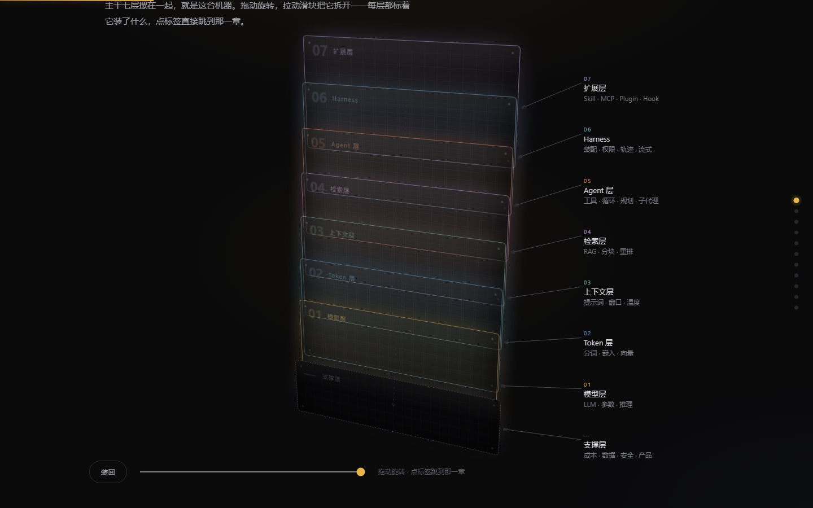

<div align="center">

<h1>AI 零件大全</h1>

<p><strong>把 183 个 AI 名词，讲成一个完全不懂 AI 的人也能听懂的东西。</strong></p>

<p>模型是脑子 · 上下文是工作台 · 工具是手脚 · Agent 是干活的人 · Harness 是办公室</p>

<p>
  <a href="#技术说明"></a>
  <a href="#技术说明"></a>
  <a href="LICENSE"></a>
</p>



</div>

---

## 这是什么

一个**看得懂**的 AI 术语地图，两副面孔：

- **一份 Markdown 全文**（[`AI零件大全.md`](AI零件大全.md)）—— 平铺直叙，随便搜。
- **一个单页网站**（[`index.html`](index.html)）—— 暗色、有动画、能上手玩。

两者由**同一份数据**生成，不会出现“文档和网页说法不一致”。

做这个的原因很简单：市面上的 AI 科普要么太浅（“AI 就是会学习的程序”），要么一上来就是论文词汇。真正卡住新人的，是**词与词之间的关系**——为什么有了大模型还需要 Agent，为什么有了 Agent 还需要 Harness。所以这里每个词只回答三件事：

> **是什么 · 像什么 · 别搞混什么**

“像什么”一律用生活里的东西：厨师、厨房、工作台、点菜单、插座、门禁卡。

## 快速开始

不需要安装、不需要联网、不需要构建。

**方式一**：直接双击 `index.html`，用浏览器打开。

**方式二**：本地起个静态服务（避免个别浏览器的 `file://` 限制）：

```bash
python -m http.server 8000
# 打开 http://localhost:8000
```

**方式三**（发布到网上）：仓库 Settings → Pages → Source 选 `Deploy from a branch` → 分支选 `main`、目录选 `/ (root)`，保存即可。根目录的 `index.html` 会被直接托管。

## 里面有什么

**183 个词，分 11 层**，从“大脑”一路讲到“货架”：

| 层 | 讲什么 | 代表词 |
| --- | --- | --- |
| 01 模型层 | 它怎么被练出来、肚子里有什么 | LLM、Transformer、参数、幻觉 |
| 02 Token 层 | 文字怎么变成数字 | Token、分词器、嵌入、向量 |
| 03 上下文与提示 | 模型眼前的那张桌子 | 提示词、系统提示词、上下文窗口、温度 |
| 04 检索与记忆 | 会查资料、会记事 | RAG、分块、重排、引用 |
| 05 Agent 层 | 长出手脚，自己把事办完 | 工具、函数调用、子代理、沙箱 |
| 06 Harness 层 | 真正让它跑起来的那层壳 | 运行时、流式、轨迹、上下文装配 |
| 07 扩展层 | 四种“外挂”的区别 | Skill、MCP、Plugin、Hook |
| 08 成本与性能 | 钱是按 token 烧的 | KV 缓存、提示词缓存、TTFT |
| 09 数据与评测 | 怎么教、怎么考 | 预训练数据、Benchmark、过拟合 |
| 10 安全与治理 | 能力越大越需要围栏 | 护栏、越狱、审计、红队 |
| 11 产品与生态 | 货架上你能买到的 | API、Copilot、多模态、AGI |

另有两块“把零件装回去”的内容：

- **一次请求的完整旅程** —— 从你按下回车到看见第一个字，九步时间线，标出每一步用到了哪些零件。
- **十二个最常见的误解** —— “它会记得上次聊的”“上下文窗口越大越好”……逐条辟谣。

## 页面亮点

- **3D 拆解图** —— 七层摞成一台机器，拖动旋转、拉滑块拆开/装回，箭头标注实时跟着 3D 投影走。纯 CSS 3D + 手写投影，没有 three.js。
- **6 个可交互演示** —— 分词切块、上下文窗口成本、检索打分与引用、Agent 循环、四种外挂对比、缓存前后对比。
- **默认只展开核心词** —— 共 56 个核心词，其余收在“展开另外 N 个词”里；核心词太少的章节（≤3 个）默认全展开，免得空荡。
- **183 词全文索引** —— 中英文都能搜，点结果自动展开所在章节并跳过去。
- **会降级** —— 系统开了“减少动态效果”就关掉所有动画；移动端单列重排；没有 JS 时给出 Markdown 入口。

## 目录结构

```text
.
├─ index.html            # 页面骨架
├─ styles.css            # 全部样式：暗色、动效、3D、响应式
├─ app.js                # 渲染 + 滚动动画 + 6 个演示 + 3D 拆解
├─ data.js               # 183 个词的数据（自动生成，别手改）
├─ AI零件大全.md          # 纯文本全文（自动生成，别手改）
├─ assets/               # 预览截图
└─ build/
   ├─ content_a.py       # 词条：模型层 / Token / 上下文 / 检索
   ├─ content_b.py       # 词条：Agent / Harness / 扩展 / 成本
   ├─ content_c.py       # 词条：数据评测 / 安全 / 产品 + 12 个误解
   ├─ generate.py        # 由上面三份生成 .md 与 data.js
   ├─ check.mjs          # 无头浏览器交互自检（CDP）
   └─ shoot.mjs          # 整页截图脚本（CDP）
```

## 怎么改内容

**唯一的数据源是 `build/content_*.py`。** 改完跑一次生成脚本，Markdown 和网页会一起更新：

```bash
python build/generate.py
# terms: 183 core: 56 layers: 11 ...
```

只用到 Python 标准库，不需要 pip 安装任何东西。

词条格式（`T(中文名, 英文名, 一句话, 像什么, 别搞混, 是否核心词)`）：

```python
T("大语言模型", "LLM",
  "专门练“下一个词该是什么”的超大模型",
  "像一个读完了整个互联网、特别会接话的人",
  "", True)   # 第 6 个参数 True = 核心词，默认展示
```

想加一个新词，往对应的 `content_*.py` 里加一行就行；词数、章节计数、索引会自动跟着变。

## 技术说明

- **零依赖**：没有框架、没有 CDN、没有构建步骤，断网可用。
- **3D**：`perspective` + `preserve-3d` + `translate3d`，标签与箭头的屏幕坐标由手写投影函数实时计算，保证旋转时标注不错位。
- **动画**：`IntersectionObserver` 触发入场，`requestAnimationFrame` 驱动循环演示，其余是 CSS transition。
- **体积**：整站不到 130 KB 源码（未压缩，不含截图）。
- **兼容**：开发与截图验证都在 Chrome 上完成。用的是 `clamp()`、CSS 3D、`IntersectionObserver`、`mask-image` 这类已经标准化多年的特性，Safari / Firefox 理论上一致，但没有逐一实测——遇到问题欢迎开 issue。

调试参数：

- `index.html?qa=1` —— 关闭入场动画，方便截图与视觉检查。
- `index.html?qa=1&to=ch-agent` —— 直接定位到某一节。

## 参与贡献

欢迎 PR，尤其是这几类：

- **纠正事实**：哪个定义不准、哪个类比会误导。
- **补词**：你觉得“新人一定会撞上、但这儿没有”的词。
- **翻译**：英文版（术语表结构已经是中英对照，改 `generate.py` 的输出即可）。
- **无障碍**：键鼠操作、对比度、读屏。

改动前请先跑一次：

```bash
# 需要本机装有 Chrome（没有的话用 CHROME_PATH 指定）
node build/check.mjs "file:///<你的绝对路径>/index.html"
```

它会输出十几项交互断言（卡片数、折叠、搜索跳转、3D 标注、演示动画、JS 报错），全绿再提 PR 比较稳。

## 声明

- 词条里的数字（延迟、成本、缓存折扣）都是**示意值**，用来表达量级关系，不是任何厂商的真实报价。
- 提到的产品名（vLLM、LangChain、Ollama 等）只作为“这一类东西”的例子，不构成推荐。
- 内容优先保证“讲得通”，不追求学术上的完备定义。

## 许可

[MIT](LICENSE) © 2026
